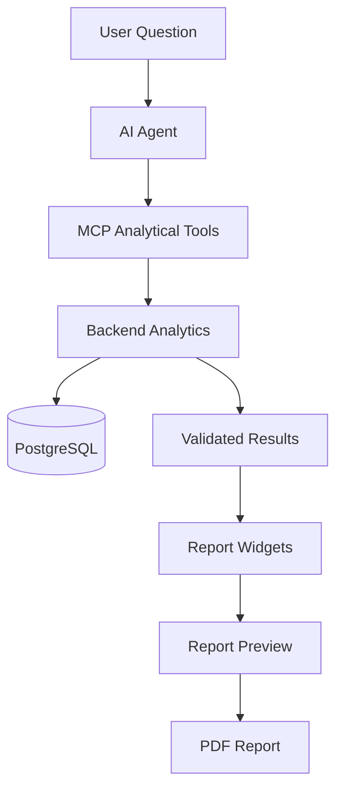
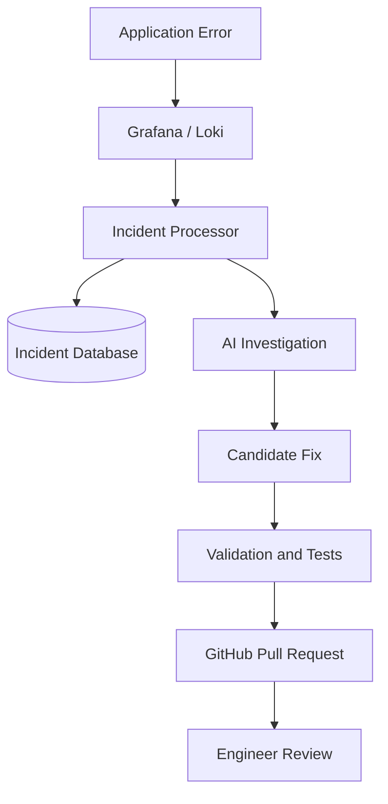

<!-- ================= HERO ================= -->

<div align="center">

# Hey, I'm Rithik V 👋

### AI Engineer | Agentic AI | Machine Learning

<a href="https://git.io/typing-svg">
  
</a>

<br/>

[](https://www.linkedin.com/in/rithik-v-11465425a/)
[](mailto:rithikv6@gmail.com)
[](https://github.com/rithik6)

</div>

---

## 👨‍💻 About Me

I'm an **AI Intern at APMS.AI**, with an Integrated
M.Sc. in Computer Science specializing in
Artificial Intelligence and Machine Learning.

My interests lie at the intersection of
**Generative AI, agentic systems, machine learning,
backend engineering, and production-oriented AI**.

- 🔭 Working on AI-powered industrial analytics
  and intelligent report generation at APMS.AI
- 🤖 Building with LLMs, RAG, MCP, LangChain
  and LangGraph
- 🛠️ Interested in reliable agent workflows,
  tool orchestration and AI backend systems
- 🐍 Python and FastAPI enthusiast
- 🎯 Exploring AI Engineer, Generative AI Engineer
  and Machine Learning Engineer opportunities

---

## 🚀 What I'm Working On

<table>
<tr>
<td width="50%" valign="top">

### 📊 AI Analytics Report Builder

An AI-powered analytics and reporting system
being developed at APMS.AI.

**Focus areas:**

- Natural-language analytics
- MCP-based tool integration
- OEE, production and downtime analysis
- LLM-driven analytical tool selection
- Interactive report generation
- Reusable report template architecture

**Technologies**

`Python` `MCP` `PostgreSQL`
`LLMs` `Jinja` `WeasyPrint`

</td>
<td width="50%" valign="top">

### 🛠️ AI Bug-Fixing Agent

An AI-assisted incident investigation
and bug-fixing proof of concept.

**Focus areas:**

- Centralized log investigation
- Incident processing and prioritization
- LLM-assisted code investigation
- Automated patch validation
- Regression testing
- Human-reviewed GitHub pull requests

**Technologies**

`Python` `FastAPI` `PostgreSQL`
`Grafana` `Loki` `Claude` `Docker`

</td>
</tr>
</table>

<details>
<summary><b>🔎 Explore the Analytics Agent Architecture</b></summary>

<br/>

The architecture separates AI-driven tool selection
from backend-owned database operations and calculations.



The MCP layer exposes approximately 19
analytical tools covering manufacturing KPIs
and machine-performance analytics.

Report template saving, editing and
parameterized regeneration are part
of the evolving system design.

</details>

<details>
<summary><b>🔎 Explore the AI Bug-Fixing POC</b></summary>

<br/>



The POC explores controlled agent execution,
validation, bounded retries and human approval.

</details>

---

## 🧰 Technical Toolbox

<div align="center">

### Languages & Backend


### Machine Learning & Data


### Development Tools


</div>

### 🤖 Generative AI & Agentic Systems


---

## 🌟 Featured Projects

### 🤖 Recruit-Agent Pro

**AI-powered resume analysis and career intelligence**

- LLM-based candidate and job analysis
- PDF parsing and information extraction
- Semantic retrieval and contextual evaluation
- Evidence-grounded skill recommendations
- Llama 3.1 inference through Groq

**Stack:** Python, LangChain, Llama 3.1,
Groq, PyMuPDF, Streamlit

[](https://recruit-agent-pro-sqdtiqm9wodfubdpngzokh.streamlit.app/)

<details>
<summary><b>Read more about the pipeline</b></summary>

<br/>

```text
Resume / Job Description
          |
          v
    Document Parsing
          |
          v
    Context Extraction
          |
          v
   LLM Skill Evaluation
          |
          v
 Structured Recommendations
```

</details>

---

### ❤️ Heart Attack Risk Prediction

**Machine learning classification using healthcare data**

- Data cleaning and preprocessing
- Missing-value handling and feature engineering
- Categorical feature encoding
- Logistic Regression, Decision Tree,
  and Random Forest model comparison
- Exploratory visualizations

**Stack:** Python, Pandas, Scikit-learn,
Matplotlib, Seaborn

[](https://github.com/rithik6/heart-attack-risk-prediction)

<details>
<summary><b>View model comparison details</b></summary>

<br/>

Models evaluated:

1. Logistic Regression
2. Decision Tree
3. Random Forest

Random Forest recorded the highest
accuracy among the tested models at 56%.

This was an exploratory machine learning
project, not a clinical diagnostic tool.

</details>

---

## 📈 GitHub Analytics

<div align="center">


<br/>


</div>

---

## 🧠 Engineering Principles

<details>
<summary><b>⚡ How I approach AI engineering</b></summary>

<br/>

**1. Ground AI in real data**  
Use trusted tools and backend-owned business logic
rather than relying on unsupported LLM calculations.

**2. Keep systems modular**  
Separate agents, tools, application services,
data access and validation.

**3. Validate before shipping**  
Use testing, controlled execution,
and human review for risky changes.

**4. Think beyond the demo**  
Consider latency, cost, reliability,
observability and maintainability.

</details>

---

## 🤝 Let's Connect

I'm interested in connecting with developers,
researchers and engineering teams working on:

- Generative AI and LLM applications
- Agentic AI and MCP integrations
- Machine learning and data-driven systems
- Backend engineering and AI infrastructure

<div align="center">

[](https://www.linkedin.com/in/rithik-v-11465425a/)

[](mailto:rithikv6@gmail.com)

<br/><br/>

**Building intelligent systems, one workflow at a time. 🚀**

</div>
